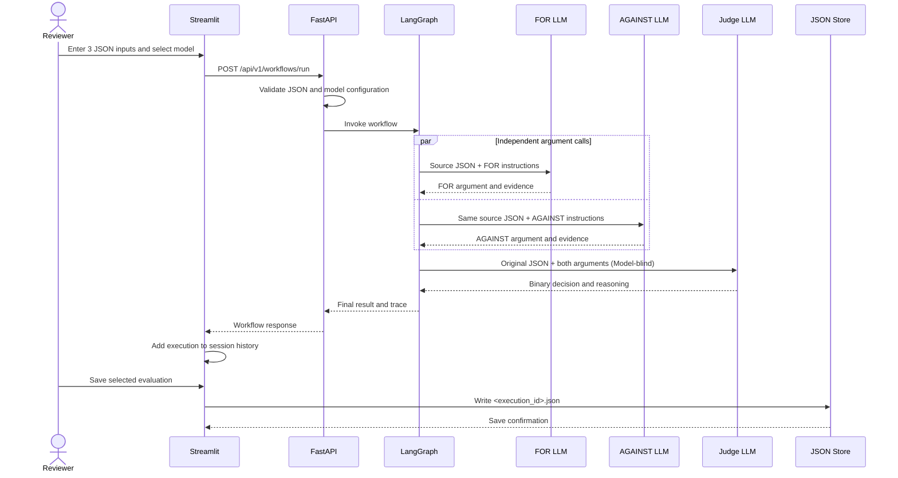

# System Architecture

## Hiring Manager Evaluation Lab

**Version:** 1.0  

---

### 1. Architecture Goals
- Transparent three-agent workflow.
- Independent and parallel FOR/AGAINST reasoning.
- A Judge that can verify both arguments against the original inputs.
- Model interchangeability without changing graph logic.
- Inspectable execution traces.
- Lightweight persistence without a database.

---

### 2. Logical Components
- **Streamlit UI:** Single application with Workflow tab and Evaluations tab.
- **FastAPI Service:** Stable HTTP boundary between UI and workflow.
- **Model Registry & Adapters:** Resolves user-facing model config to provider and model identifier.
- **LangGraph Workflow:** Coordinates concurrent FOR/AGAINST branches and the sequential Judge.
- **Trace Collector:** Orchestration-level capture of per-node inputs, outputs, timings, and statuses.
- **JSON Evaluation Store:** Local file-based persistence (`data/evaluations/<execution_id>.json`).

---

### 3. Workflow Sequence

---

### 4. Failure Paths & Constraints
- If FOR fails: record failure; skip Judge.
- If AGAINST fails: record failure; skip Judge.
- If both succeed but Judge fails: record both arguments + Judge failure; do not manufacture a decision.
- If persistence fails: retain session result and display save error.
- Corrupted file: show record as unavailable with visible warning; do not overwrite.
- Key constraints: No database, no LangSmith, no web search, no automatic retries, no third outcome.
